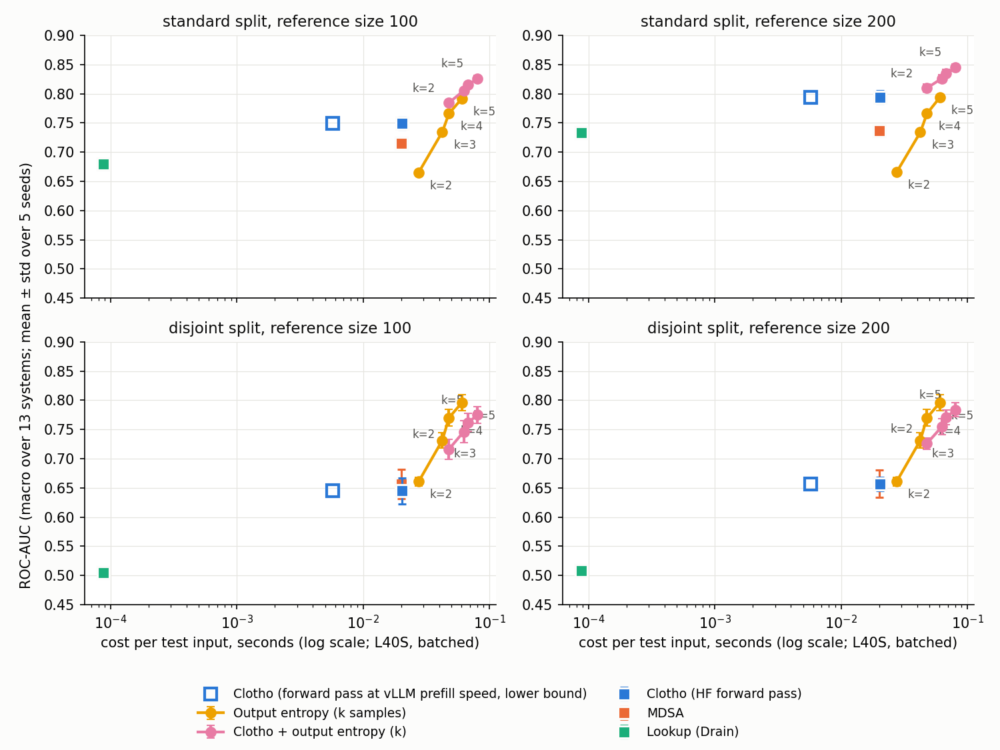

# Cost vs quality: output entropy from k samples vs Clotho

Generated by `experiments/log_parsing_cost_quality.py` (protocol in its docstring); timings by `experiments/log_parsing_timing.py` on one NVIDIA L40S. Main setting fair_leakfree (label from samples 5-9, never used by any score). AUC cells: mean ± std over 5 seeds of the macro mean over 13 systems.

| method | s / input (batched) | s / input (batch 1) | standard @100 | standard @200 | disjoint @100 | disjoint @200 |
|---|---|---|---|---|---|---|
| Clotho | 0.0202 | 0.0414 | 0.749 ± 0.010 | 0.794 ± 0.011 | 0.645 ± 0.022 | 0.657 ± 0.012 |
| Clotho, forward pass at vLLM prefill speed (lower bound) | 0.0058 | n/a | 0.749 ± 0.010 | 0.794 ± 0.011 | 0.645 ± 0.022 | 0.657 ± 0.012 |
| MDSA | 0.0200 | 0.0411 | 0.715 ± 0.008 | 0.737 ± 0.006 | 0.656 ± 0.025 | 0.657 ± 0.023 |
| Lookup (Drain) | 0.0001 | 0.0001 | 0.680 ± 0.006 | 0.733 ± 0.005 | 0.505 ± 0.005 | 0.508 ± 0.003 |
| Output entropy, k=2 | 0.0275 | 1.3200 | 0.665 ± 0.002 | 0.666 ± 0.004 | 0.661 ± 0.008 | 0.661 ± 0.008 |
| Output entropy, k=3 | 0.0424 | 1.4315 | 0.734 ± 0.002 | 0.734 ± 0.003 | 0.731 ± 0.013 | 0.731 ± 0.013 |
| Output entropy, k=4 | 0.0478 | 1.4711 | 0.766 ± 0.001 | 0.766 ± 0.005 | 0.770 ± 0.014 | 0.770 ± 0.014 |
| Output entropy, k=5 | 0.0604 | 1.5502 | 0.792 ± 0.001 | 0.794 ± 0.005 | 0.796 ± 0.014 | 0.796 ± 0.014 |
| Clotho + output entropy, k=2 | 0.0477 | 1.3614 | 0.784 ± 0.005 | 0.810 ± 0.007 | 0.716 ± 0.017 | 0.726 ± 0.010 |
| Clotho + output entropy, k=3 | 0.0626 | 1.4729 | 0.805 ± 0.005 | 0.826 ± 0.007 | 0.746 ± 0.019 | 0.754 ± 0.014 |
| Clotho + output entropy, k=4 | 0.0680 | 1.5126 | 0.815 ± 0.005 | 0.835 ± 0.007 | 0.762 ± 0.015 | 0.771 ± 0.013 |
| Clotho + output entropy, k=5 | 0.0806 | 1.5916 | 0.826 ± 0.005 | 0.845 ± 0.006 | 0.775 ± 0.014 | 0.784 ± 0.012 |

(k = 1 gives AUC 0.5: one sample has entropy 0.) Mean generated tokens per sample: k=2: 51, k=3: 51, k=4: 51, k=5: 51.

Timing components (s / input, mean over HDFS, Hadoop, BGL, OpenStack): HF forward pass, layers 1-16, batch 32: 0.0197; the extraction pipeline used for the results (all layers, batch 1): 0.0409; vLLM prefill only (max_tokens=1, lower bound for a forward pass): 0.0052; PCA+GMM scoring: 0.00053; PCA+MDSA: 0.00027. Batched layer-16 vectors match the stored ones (min cosine 0.9996).

Cost ratios, output entropy(k) over Clotho: batched with Clotho on HF k=2: 1.4x, k=3: 2.1x, k=4: 2.4x, k=5: 3.0x; batched with Clotho at vLLM prefill speed (same engine) k=2: 4.8x, k=3: 7.3x, k=4: 8.3x, k=5: 10.5x; batch 1 (online) k=2: 32x, k=3: 35x, k=4: 36x, k=5: 37x.

## Paired per-seed differences: output entropy(k) minus Clotho

| k | standard @100 | standard @200 | disjoint @100 | disjoint @200 |
|---|---|---|---|---|
| 2 | -0.084 ± 0.011 | -0.128 ± 0.013 | +0.016 ± 0.022 | +0.004 ± 0.013 |
| 3 | -0.014 ± 0.011 | -0.060 ± 0.012 | +0.086 ± 0.020 | +0.075 ± 0.012 |
| 4 | +0.017 ± 0.010 | -0.028 ± 0.012 | +0.125 ± 0.025 | +0.113 ± 0.017 |
| 5 | +0.043 ± 0.010 | -0.001 ± 0.013 | +0.151 ± 0.026 | +0.139 ± 0.017 |

Smallest k with mean output-entropy AUC >= Clotho: standard @100: 4, standard @200: > 5, disjoint @100: 2, disjoint @200: 2.

