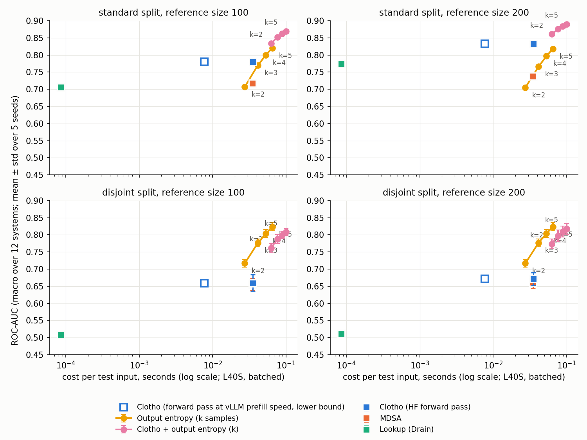

# Cost vs quality: output entropy from k samples vs Clotho (gemma)

Generated by `experiments/log_parsing_cost_quality.py` (protocol in its docstring); timings by `experiments/log_parsing_timing.py` on one NVIDIA L40S. Main setting fair_leakfree (label from samples 5-9, never used by any score). AUC cells: mean ± std over 5 seeds of the macro mean over 12 systems.

| method | s / input (batched) | s / input (batch 1) | standard @100 | standard @200 | disjoint @100 | disjoint @200 |
|---|---|---|---|---|---|---|
| Clotho | 0.0351 | 0.0585 | 0.780 ± 0.003 | 0.832 ± 0.005 | 0.659 ± 0.025 | 0.671 ± 0.019 |
| Clotho, forward pass at vLLM prefill speed (lower bound) | 0.0077 | n/a | 0.780 ± 0.003 | 0.832 ± 0.005 | 0.659 ± 0.025 | 0.671 ± 0.019 |
| MDSA | 0.0348 | 0.0583 | 0.718 ± 0.007 | 0.737 ± 0.006 | 0.655 ± 0.017 | 0.661 ± 0.017 |
| Lookup (Drain) | 0.0001 | 0.0001 | 0.706 ± 0.009 | 0.774 ± 0.008 | 0.508 ± 0.002 | 0.512 ± 0.001 |
| Output entropy, k=2 | 0.0274 | 1.1955 | 0.707 ± 0.003 | 0.705 ± 0.005 | 0.717 ± 0.011 | 0.717 ± 0.011 |
| Output entropy, k=3 | 0.0415 | 1.2147 | 0.770 ± 0.003 | 0.766 ± 0.004 | 0.777 ± 0.012 | 0.777 ± 0.012 |
| Output entropy, k=4 | 0.0532 | 1.2923 | 0.800 ± 0.002 | 0.797 ± 0.003 | 0.804 ± 0.012 | 0.804 ± 0.012 |
| Output entropy, k=5 | 0.0648 | 1.2776 | 0.821 ± 0.002 | 0.818 ± 0.003 | 0.824 ± 0.012 | 0.824 ± 0.012 |
| Clotho + output entropy, k=2 | 0.0625 | 1.2540 | 0.834 ± 0.002 | 0.861 ± 0.006 | 0.762 ± 0.013 | 0.773 ± 0.014 |
| Clotho + output entropy, k=3 | 0.0766 | 1.2732 | 0.852 ± 0.002 | 0.876 ± 0.005 | 0.788 ± 0.013 | 0.798 ± 0.017 |
| Clotho + output entropy, k=4 | 0.0883 | 1.3508 | 0.862 ± 0.002 | 0.884 ± 0.005 | 0.800 ± 0.011 | 0.809 ± 0.016 |
| Clotho + output entropy, k=5 | 0.1000 | 1.3361 | 0.869 ± 0.002 | 0.890 ± 0.005 | 0.808 ± 0.010 | 0.818 ± 0.016 |

(k = 1 gives AUC 0.5: one sample has entropy 0.) Mean generated tokens per sample: k=2: 40, k=3: 40, k=4: 40, k=5: 40.

Timing components (s / input, mean over HDFS, Hadoop, BGL, OpenStack): HF forward pass, layers 1-21, batch 32: 0.0346; the extraction pipeline used for the results (all layers, batch 1): 0.0580; vLLM prefill only (max_tokens=1, lower bound for a forward pass): 0.0073; PCA+GMM scoring: 0.00048; PCA+MDSA: 0.00022. Batched layer-21 vectors match the stored ones (min cosine 0.9997).

Cost ratios, output entropy(k) over Clotho: batched with Clotho on HF k=2: 0.8x, k=3: 1.2x, k=4: 1.5x, k=5: 1.8x; batched with Clotho at vLLM prefill speed (same engine) k=2: 3.5x, k=3: 5.4x, k=4: 6.9x, k=5: 8.4x; batch 1 (online) k=2: 20x, k=3: 21x, k=4: 22x, k=5: 22x.

## Paired per-seed differences: output entropy(k) minus Clotho

| k | standard @100 | standard @200 | disjoint @100 | disjoint @200 |
|---|---|---|---|---|
| 2 | -0.073 ± 0.005 | -0.128 ± 0.005 | +0.057 ± 0.033 | +0.046 ± 0.024 |
| 3 | -0.010 ± 0.004 | -0.066 ± 0.004 | +0.117 ± 0.032 | +0.106 ± 0.022 |
| 4 | +0.019 ± 0.004 | -0.036 ± 0.005 | +0.144 ± 0.033 | +0.133 ± 0.022 |
| 5 | +0.040 ± 0.005 | -0.014 ± 0.005 | +0.164 ± 0.033 | +0.152 ± 0.022 |

Smallest k with mean output-entropy AUC >= Clotho: standard @100: 4, standard @200: > 5, disjoint @100: 2, disjoint @200: 2.

